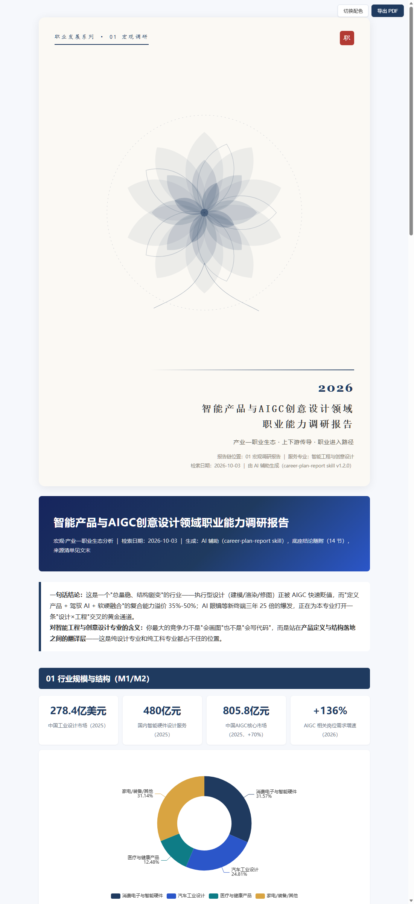
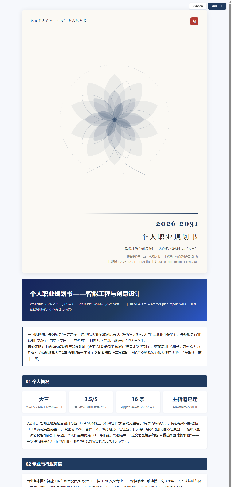

# career-plan-report · 职业发展双报告生成器

> **AI 驱动的个人职业决策系统**：一份行业职业地图（宏观）× 一份个人职业规划书（微观），从"行业由什么构成"到"我该怎么走"，全链路可复现。

[]() []() []()



## 这是什么

一个面向 AI Agent（如 WorkBuddy / Claude 类工具）的 **Skill**：加载后，Agent 即可为主营专业跑通完整的职业规划流水线——

```text
行业与政策检索 ──────→ 01 宏观：《XX领域职业能力调研报告》（产业—职业生态分析）
问卷采集 → 画像 → 决策 ──→ 02 微观：《个人职业规划书》（个人职业决策分析）
```

**核心公式**：`个人规划 = 个人状态 × 行业机会 × 职业偏好 × 能力差距 × 现实约束`

## 核心特性（v1.2.0）

### 1. 产业—职业生态分析（宏观不再是"招聘网站统计"）
宏观工作流内置 **M1~M11**：行业边界 → 产业结构 → **产业链上下游** → 企业类型生态 → 岗位生态四列表（环节×企业→岗位→能力）→ 技能需求迁移 → 区域分布 → 政策锚点 → **上下游传导分析**（至少 2 条"上游变化→下游岗位影响"传导链）→ **人才链**（职业是产业链上的一个位置）→ 职业进入路径。检索结论沉淀为 **14 节 `底座结论.md`**，微观阶段直接引用。

### 2. 静态题库问卷（选项是知识资产，不是运行时产物）
- 问卷 = 通用骨架（8 信息层 19 题）+ **行业静态预设**（`question-bank/industries/`：ai / smart-design / chinese-language-literature），部署时"选行业 → 原样合并 → 一次性定稿"，**禁止运行时生成或改写选项**——省算力、省时间、可复用、可追溯。
- 信息不足时从静态题库（`question-bank/common/`）**挑选已有问题**对话补问，不生成新题。
- 采集闭环：MD 问卷唯一真源 → `questionnaire.hta` 双击渲染 → 提交自动写回「已填写 MD」+ `answers-auto.json`，Agent 直接读取，无需复制粘贴。

### 3. 自述即依据（不收集证明材料）
能力画像的依据 = **用户自述 + 问卷回答 + 对话补充 + 已知经历**。六维评分逐项附自述依据与**置信度（高/中/低）**，禁止要求证书/截图/代码仓库。分析比证明更重要。

### 4. 中国城市级地图插件（离线、PDF 友好）
`assets/china-map/`：SVG 真矢量市级色块地图，4 档配色 + 省界图层 + 高亮城市引导线，`layoutCenter` 锁比例不拉伸，file:// 离线渲染、打印不丢；附数据重建脚本（DataV.GeoAtlas 源）。

### 5. 印刷级 HTML 报告
整页艺术封面（打印独占第 1 页）· 红/蓝/绿/橙四主题循环 · 一键导出 PDF（`@page margin:0` 消除页眉页脚）· beforeprint 图表智能重排（地图例外分支，防裁切）· ECharts 全部本地引用含 CDN 双兜底 · **图表渲染硬校验**（dump-dom 计数 + 成对审计）。

## 仓库结构

```text
career-plan-report/          ← Skill 源码（加载入口：SKILL.md）
├── workflows/               ← macro.md（M1~M11）/ micro.md（B1~B12）
├── references/              ← 打印规范 / 问卷模板 / 静态题库（common + industries）
├── templates/               ← 规划书 HTML 骨架 / AI 使用记录模板
└── assets/                  ← echarts 本地包 / china-map 地图插件 / questionnaire.hta 问卷壳

example/职业规划-智能工程与创意设计-沈亦航/   ← 完整产出示例（v1.2.0 全链实跑）
├── 01-宏观调研报告/         ← report.html + 底座结论.md（14 节）
├── 02-个人规划书/           ← report.html（16 章决策分析）
├── 00-问卷模板.md 等三件套   ← 静态预设问卷 + 已填写版本 + answers-auto.json
└── 00-问卷与画像.md         ← 补问记录 + 六维画像（自述依据+置信度）
```

## 快速开始

1. **加载 Skill**：把 `career-plan-report/` 放入你的 Agent skills 目录，对话中说"帮我做一份职业能力调研报告 / 个人职业规划书"即可触发。
2. **问卷采集**：Agent 会按专业选择行业预设生成 `00-问卷模板.md`，部署三件套后双击 `questionnaire.hta` 填写提交。
3. **报告生成**：产出 HTML 报告，浏览器打开即用——右上角切换配色 / 导出 PDF（打印对话框中边距选"无"）。

> **查看示例**：直接用浏览器打开 `example/` 下两个 `report.html`（本地文件即可，图表全部离线渲染）。

## 设计原则

- **问卷选项是静态知识资产**——设计期完成多维覆盖，运行时只选题、不改题。
- **自述即依据**——目标是获得足以支持职业判断的信息，不是收集证明材料。
- **真实性零容忍**——禁止编造企业名、岗位名、薪酬数据；不可溯源的机会宁少勿假。
- **反废话**——"随着社会发展"类空话一字不多写，每个结论可回溯到证据编号。

## 示例截图



## License

MIT © [BigYUE](https://github.com/BigYUE-7)
